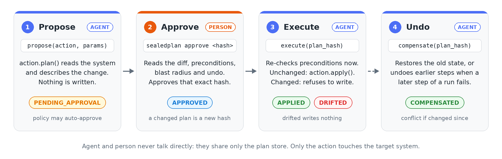

[](https://github.com/sealedplan/sealedplan/actions/workflows/ci.yml)
[](python/sealedplan/pyproject.toml)
[](LICENSE)
[](spec/SPEC.md)
[](#repository)
[](https://github.com/astral-sh/uv)
[](https://github.com/astral-sh/ruff)
[](https://mypy-lang.org/)

# sealedplan

**Approve the change, not the tool call.**

## The problem

Agents now change real systems: databases, Kubernetes, Terraform, SaaS APIs. The usual
safeguard is a prompt such as *"The agent wants to call `terraform apply`. Allow?"* That
approval protects less than it seems:

- **You approve the agent's words, not the effect.** The prompt shows the tool name and
  the arguments the agent chose. It doesn't show which resources will be destroyed, what
  a row holds now, or how many users a change affects.
- **Nothing binds the "yes" to what runs.** After approval, the agent can retry with
  different arguments, or the plan can be regenerated. The approval still counts.
- **The world moves between approval and execution.** Someone edits the row, or a deploy
  changes the cluster. The approved change then runs anyway and silently overwrites their
  work.
- **There's no reliable undo.** When step 3 of a run fails, steps 1 and 2 stay half-done.
- **Every call asks, so people stop reading.** Approving a harmless read and a database
  drop look the same, and soon both get a reflexive "yes".

## What sealedplan does

The person approves a **plan** of what will actually happen, and only that plan, in
that world, can run.

- **See what will really happen.** The plan comes from the target system itself,
  through its own dry-run or a read of the current state, not from the agent. It shows
  before and after, blast radius, and how to undo the change.
- **The approval is sealed to the plan.** The approval names the plan's hash. If the
  plan changes by one byte, it needs a new approval.
- **A stale approval writes nothing.** Just before applying, the runtime checks that the
  system still looks as it did when the person approved. If it doesn't, the result is
  `DRIFTED` and nothing is written, like Terraform with a stale saved plan.
- **Undo is built in, and safe.** Every plan carries its undo. Undo refuses to overwrite
  a change someone made afterwards, and a failed multi-step run undoes its earlier steps.
- **People only where it matters.** Policy looks at the plan's effect and risk. It
  approves low-risk reversible changes automatically, asks one person for risky ones and
  two people for destructive ones.

sealedplan does not replace human judgment. It makes a person's approval mean exactly
what they saw, and only while it is still true.

This is **not** a new protocol and **not** a gateway. It is one protocol-neutral
contract with bindings for MCP and A2A, plus a reference runtime.

## How it works

There are three parties. Only the action touches the target system.



- **An action** is a class that knows one kind of change on one system, for example
  "update a row" or "scale a deployment". It answers four questions: what would this
  change do (`plan`), what does the resource look like now (`observe`), make the change
  (`apply`), and undo it (`compensate`).
- **A plan** is what a person approves: before/after, preconditions such as "row
  version is still 4", blast radius, risk, and how to undo it. It is hashed, and the
  approval names that hash. A plan that changes after approval is no longer approved.
- **The runtime** decides from the plan's effect and risk whether a person must
  approve. It refuses to apply anything not approved, re-checks preconditions just
  before applying, and keeps an append-only record of every transition.
- **The person** approves with the `sealedplan` CLI. It reads the same store and shows
  the plan as it was hashed, not the agent's summary of it.

The agent and the person never talk to each other directly. They share a plan store, a
SQLite file in this runtime.

## Try it

```bash
uv sync
```

```bash
uv run python examples/sql_agent/crm_agent.py demo
```

This demo has an agent propose a change to a customer record. A person approves it with
the CLI, and the agent executes it. Then a second change drifts and is refused, and the
first change is undone. [`examples/`](examples) also has a step-by-step version for two
terminals, and an example of writing your own action.

## Using it in code

Set up a runtime and give it the actions this agent may use. Each action holds its own
allowlist: here, which table and columns.

```python
import sqlite3
from sealedplan.models import Principal
from sealedplan.providers.sql import Table, UpdateRow
from sealedplan.runtime import Runtime
from sealedplan.store import SqliteStore

AGENT = Principal(id="crm-agent", issuer="https://idp.example.com", kind="agent")
RUNTIME = Principal(id="crm-runtime", issuer="https://idp.example.com", kind="service")

rt = Runtime(SqliteStore("plans.db"), RUNTIME)
rt.register(
    UpdateRow(
        lambda: sqlite3.connect("crm.db"),
        "crm",
        {"customers": Table(key="id", version="version", columns=("tier", "credit_limit"))},
    )
)
```

The agent's tool proposes instead of acting. What it gets back is a plan and a state,
not a result:

```python
proposal = rt.propose(
    "sql.update_row",
    {"table": "customers", "key": 1, "values": {"tier": "gold"}},
    agent=AGENT,
    idempotency_key=request_id,  # of the plans sharing a key, at most one is applied
)
proposal.state  # PENDING_APPROVAL, or APPROVED if policy allows it without a person
```

A person reviews and approves it from a terminal:

```bash
sealedplan --db plans.db list
```

```bash
sealedplan --db plans.db approve <hash prefix> --as bob --issuer https://idp.example.com
```

Then the agent, or a worker, executes it:

```python
result = rt.execute(proposal.plan.plan_hash)
result.state  # APPLIED, DRIFTED (result.drift says what moved), FAILED or UNKNOWN
```

To undo, call `rt.compensate(plan_hash)`. For a multi-step run, propose each step with
`parent=Parent(run_id=..., step=n)`; if step n fails, `rt.compensate_run(run_id, n)`
undoes the earlier steps in reverse order.

A common way to wire this into an agent framework is to expose two tools:
`propose_<action>`, which returns the plan's summary and hash, and `execute_plan(hash)`,
which the agent calls once the plan is approved. The agent never gets a tool that
changes the system directly.

For MCP, [`sealedplan-mcp`](adapters/mcp) does this for you: it serves each registered
action as an MCP tool that returns `input_required` until a person approves the plan,
then drift-checks and applies on the client's retry.

```python
from sealedplan_mcp import create_server

create_server(rt, agent=AGENT).run()
```

See [`examples/mcp_server`](examples/mcp_server/crm_server.py). Adapters for LangGraph
and the Claude Agent SDK are planned.

### What the outcomes mean

| State | Meaning | What to do |
|---|---|---|
| `APPLIED` | The approved change was made. | Nothing, or `compensate` to undo. |
| `DRIFTED` | A precondition no longer held. Nothing was written. | Propose again; the person sees the new values. |
| `FAILED` | The target refused the change. Nothing was written. | Read `error`; propose again if it makes sense. |
| `UNKNOWN` | The change may or may not have happened, for example after a lost connection. | `rt.reconcile(plan_hash)` asks the action to check; if it cannot tell, a person decides. |
| `COMPENSATED` | Undone. | |
| `COMPENSATION_FAILED` | Undo refused, usually because someone changed the resource after apply. | A person decides; their change is never overwritten. |

### Who must approve

The default policy looks at the plan's effect and risk. An action declares both, and
can raise the risk for a particular plan:

| Effect | low | medium | high | critical |
|---|---|---|---|---|
| `READ_ONLY` | auto | auto | auto | approve |
| `REVERSIBLE` | auto | approve | approve | two_person |
| `COMPENSATABLE` | approve | approve | two_person | two_person |
| `IRREVERSIBLE` | approve | approve | two_person | two_person |

Pass your own `policy=` to `Runtime` to change it.

## Reference actions

| Action | System | Effect | Precondition | Notes |
|---|---|---|---|---|
| `sql.update_row` ([source](python/sealedplan/src/sealedplan/providers/sql.py)) | Any DB-API 2.0 driver | REVERSIBLE | Row `version` column, enforced in the `UPDATE ... WHERE` (atomic) | Tables and columns come from an allowlist; values are bound parameters. |
| `k8s.scale_deployment` ([source](python/sealedplan/src/sealedplan/providers/k8s.py)) | Kubernetes | REVERSIBLE | Deployment `generation`, written with `resourceVersion` (atomic) | Scaling to zero is high risk. Talks to a small `KubeApi` interface; no client is bundled yet. |
| `terraform.apply` ([source](python/sealedplan/src/sealedplan/providers/terraform.py)) | Terraform CLI | IRREVERSIBLE | State `lineage/serial`, Terraform's own stale-plan check (atomic) | Approves a saved plan file by digest and applies that file. Destroy or replace is high risk, so two people approve. Sensitive values are redacted. |

For a Terraform stack:

```python
from pathlib import Path
from sealedplan.providers.terraform import ApplyPlan, CliRunner

rt.register(
    ApplyPlan(CliRunner(), stacks={"network": Path("infra/network")}, plan_dir=Path("tfplans"))
)
rt.propose("terraform.apply", {"stack": "network"}, agent=AGENT, idempotency_key=request_id)
```

To write your own action, see
[`examples/custom_action/feature_flags.py`](examples/custom_action/feature_flags.py).

## Repository

| Path | What |
|---|---|
| [`spec/SPEC.md`](spec/SPEC.md) | The contract (v0.1 draft). Usable without any of this code. |
| [`docs/prior-art.md`](docs/prior-art.md) | Related work and how this differs. |
| [`python/sealedplan`](python/sealedplan) | Reference runtime (Python 3.11+): core, SQLite store, CLI approver, reference actions. |
| [`examples/`](examples) | Runnable examples. |
| [`adapters/mcp`](adapters/mcp) | MCP server adapter (`sealedplan-mcp`). LangGraph and Claude Agent SDK adapters are planned. |

Status: early draft. Expect breaking changes.

## License

Apache-2.0. See [LICENSE](LICENSE).
